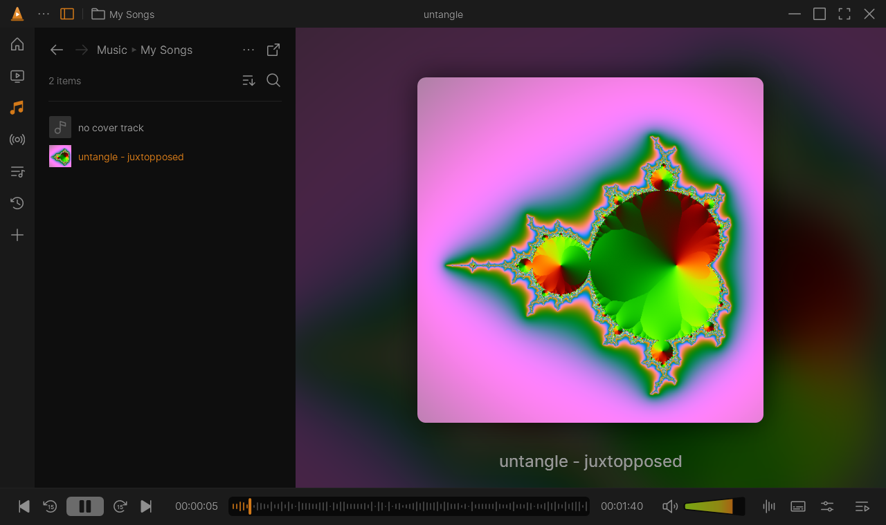
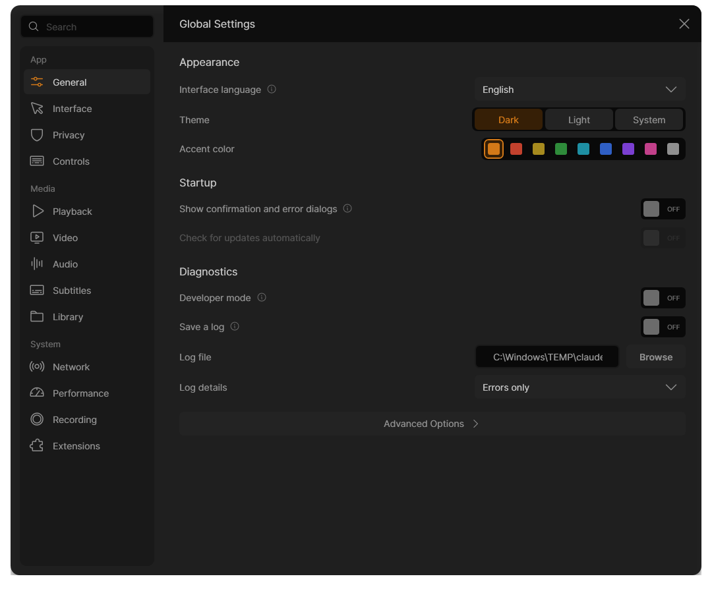
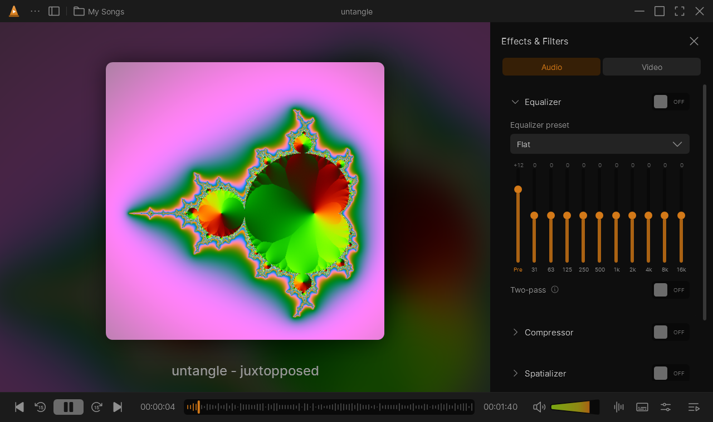
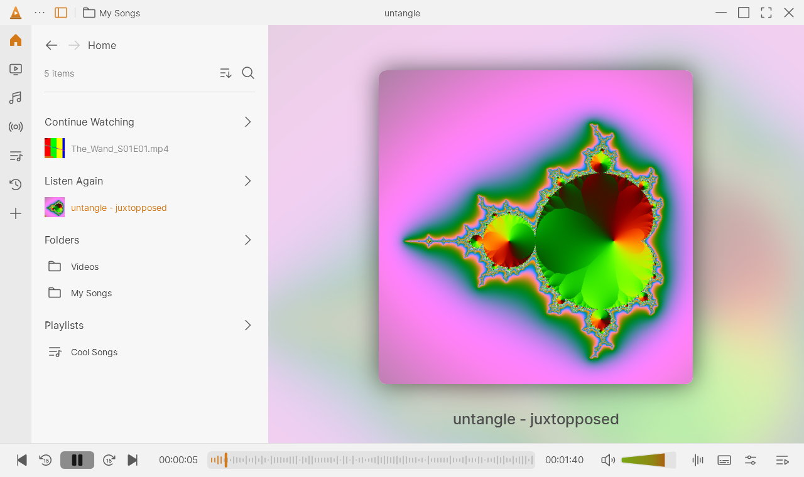
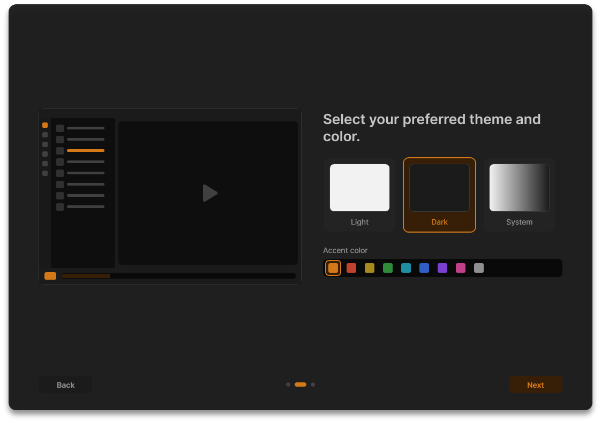

<p align="center">
  
</p>

<h1 align="center">Pylon</h1>

<p align="center">A modern, open-source media player for Windows built on the VLC engine (libVLC), with a redesigned VLC interface,
synced lyrics, an equalizer and effects, a converter and streaming to TV.</p>

<p align="center">
  <a href="https://github.com/MeowKusTrue/Pylon/releases/latest"></a>
  <a href="https://github.com/MeowKusTrue/Pylon/releases"></a>
  <a href="LICENSE"></a>
</p>

<p align="center"><a href="README.ru.md">Читать на русском</a></p>



Pylon brings **[Juxtopposed](https://www.youtube.com/@juxtopposed)'s open "VLC Redesign"** to life as a real player. Under the hood it's libVLC 3, so it plays what VLC plays: almost every audio and video format, discs, network streams.

## Features

- **Player:** rounded video frame, music mode with blurred cover art, waveform seek bar with frame previews, fullscreen with floating controls, a "hide UI" mode, and a miniplayer.
- **Library:** Home (Continue Watching, Listen Again), video and music folders, albums, artists and genres from tags, playlists with covers, history, and the play queue.
- **Network:** network streams, devices on your local network (UPnP / mDNS), podcasts (RSS), and internet radio from radio-browser.info.
- **Settings:** 13 categories and about 150 options. They apply instantly; when libVLC must restart, playback resumes where it was.
- **Effects:** a 10-band equalizer with presets, compressor, spatializer, stereo widener, pitch shift, and karaoke. For video: color, crop and rotate.
- **Themes:** dark, light, follow Windows, OLED black, Midnight, Nord and Sepia, plus 9 accent colors and adjustable corner rounding (including the window corners on Windows 11).
- **Lyrics:** syllable-by-syllable karaoke in the style of Spicy Lyrics (glow, blur by distance, click a line to jump). Reads `.ttml` (Apple / Spicy Lyrics / spicy-translate, with background vocals and duets) and `.lrc` next to the track, or finds synced lyrics on LRCLIB.
- **Video:** NVIDIA RTX / Intel Super Resolution and RTX Video HDR, chapters on the seek bar, bookmarks (`Ctrl+B`), 360° video you look around with the mouse, a blurred backdrop of the video's own frames instead of black bars.
- **Windows:** media session (track and cover in the volume flyout and on the lock screen, media keys), taskbar thumbnail buttons, own icon for every file format.
- **Websites:** YouTube, Twitch, VK, Rutube, SoundCloud and about 1,800 other sites through [yt-dlp](https://github.com/yt-dlp/yt-dlp) (downloaded on first use, kept up to date). Paste a playlist or channel and its videos join the queue.
- **Crossfade:** songs blend into each other (Settings → Playback → Crossfade between songs).
- **Phone remote:** scan a QR code and the phone's browser controls playback (⋯ → Phone Remote).
- **Playback tools:** A-B loop (`Shift+L`, range shown on the seek bar), sleep timer with a gentle fade-out, a real waveform on the music seek bar (decoded once in the background, cached).
- **Motion:** quick ease-out transitions for panels, menus, dialogs and library pages; hotkey actions stay instant, and Windows' "Animation effects" switch turns them off.
- **Audio spectrum:** live bars under the cover art, optionally over video too. Only Pylon's own sound is captured (WASAPI process loopback, Windows 10 2004+).
- **Languages:** English and Russian (Settings → General → Interface language).
- **Updates:** checks GitHub Releases at startup and updates itself in place, downloading only what changed (delta updates). After an update it shows what's new.
- **Controls:** keyboard shortcuts you can rebind (also system-wide), mouse-wheel and click actions, and a control bar you choose the buttons for.
- **Also:** record (`Shift+R`), snapshots (`Shift+S`), Chromecast, subtitle matching across a whole season, profiles, and a single instance.
- **Windows integration:** the installer registers audio and video file types, each with its own icon, and adds "Play with Pylon" to folders.

| | |
|---|---|
|  |  |
|  |  |

## Install

Download from [Releases](../../releases):

- `Pylon-win-Setup.exe` is the installer. It installs per user into `%LocalAppData%\Pylon`, without admin rights, and registers file types.
- `Pylon-win-Portable.zip` runs from any folder and updates itself too, but doesn't register file types.

Windows doesn't let apps set themselves as the default player. To choose Pylon, go to **Settings → Library → Default player**.

Coming from Pylon 1.0–1.2? Update from the app as usual. It moves to the new installer and removes the old copy; your settings and library stay.

Requires Windows 10 or 11, x64. The .NET runtime is bundled.

## Updates

Pylon checks [the latest release](../../releases/latest) at startup. You can turn this off in **Settings → General → Check for updates automatically**, or check yourself with **… → Check for Updates…**.

Click **Update now**: Pylon downloads only the files that changed (usually a few hundred KB), restarts into the new version and shows what's new in it.

## Build

You need the [.NET 10 SDK](https://dotnet.microsoft.com/download). Packaging needs [Velopack](https://velopack.io) (`dotnet tool install -g vpk`); [Inno Setup 6](https://jrsoftware.org/isdl.php) builds the small bridge that moves 1.0–1.2 installs over.

```powershell
dotnet run --project Pylon          # run from source
.\build.ps1                         # dist\releases\: installer, portable zip, update packages
.\build.ps1 -Version 1.1.0
```

### Releasing a new version

Releases are built by GitHub Actions (`.github/workflows/release.yml`). Every push to `main` is also build-checked by `ci.yml`.

1. Commit your changes to `main`.
2. Tag the version and push the tag:
   ```bash
   git tag v1.1.0
   git push origin v1.1.0
   ```
3. The workflow builds the installer, the portable zip and the full and delta update packages, and publishes the GitHub release. The release notes are this version's section of [CHANGELOG.md](CHANGELOG.md), so write it before tagging.
4. Installed copies see the update the next time they start, or right away through **Check for Updates…**.

The version number comes from the tag; you don't need to edit `Pylon.csproj`.

Keep the checkout in a short path, such as `D:\Projects\Pylon`. libVLC 3 can't load plugins from paths longer than 260 characters, and you would lose sound.

Icons come from [Phosphor](https://phosphoricons.com). To add one, use its name in code and run `python Pylon/tools/sync-icons.py <path-to-@phosphor-icons/core/assets>`.

## Credits

- [VLC / libVLC](https://www.videolan.org) and [LibVLCSharp](https://code.videolan.org/videolan/LibVLCSharp) by VideoLAN and contributors.
- The interface follows the **VLC Redesign** Figma file by Juxtopposed (see below).
- [Phosphor Icons](https://phosphoricons.com), [SharpVectors](https://github.com/ElinamLLC/SharpVectors), and [radio-browser.info](https://www.radio-browser.info).

See [THIRD-PARTY-NOTICES.md](THIRD-PARTY-NOTICES.md).

## Thanks to Juxtopposed

Pylon exists because **Juxtopposed** redesigned VLC and shared the whole design openly.
Watch how it was made — **[I Redesigned VLC After 25 Years](https://youtu.be/ERFeOgqk324)** — and see the original
**[VLC Redesign Figma file](https://www.figma.com/community/file/1691465999134370980/vlc-redesign)**. Thank you, Juxtopposed, for the thoughtful design and for making it free to build on! 💛

## License

[GPL-3.0](LICENSE). libVLC and LibVLCSharp are LGPL-2.1.

VLC and the VLC cone are trademarks of VideoLAN. Pylon is an independent project and is not affiliated with or endorsed by VideoLAN.
